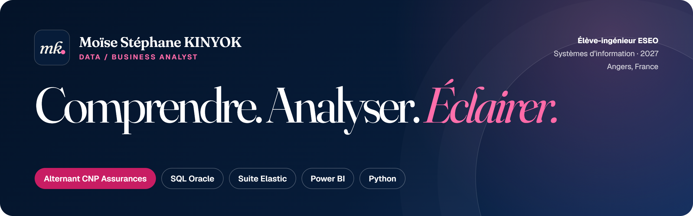
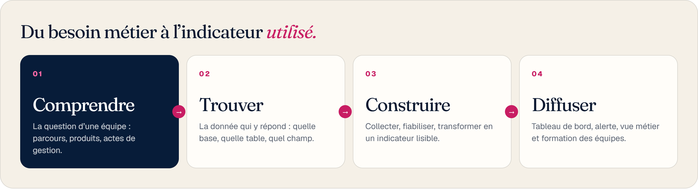
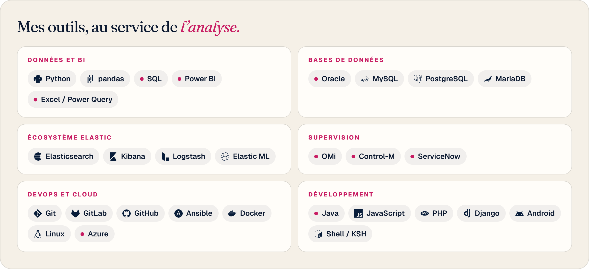
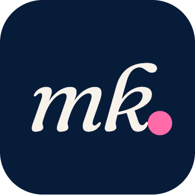

  

  
  
  
  

## Bonjour, je suis Moïse Stéphane

Élève-ingénieur à l'**ESEO** (systèmes d'information, diplôme en 2027) et **Data / Business Analyst en alternance chez CNP Assurances** à Angers.

Je comprends les parcours de gestion des contrats d'assurance vie et les besoins des équipes, puis j'exploite les données pour suivre les opérations, repérer les anomalies et fournir des indicateurs utiles à leur prise en charge.

**Je recherche un premier emploi de Data / Business Analyst à partir de septembre 2027.**

## Ce que je construis chez CNP Assurances

Un projet qui rend visible, pour les équipes support et métier, le bon déroulement des actes de gestion sur les contrats. Trois axes de suivi, sur un socle commun Elasticsearch :

| Axe | La question | Ce que j'ai fait |
| --- | --- | --- |
| **Suivi de masse** | Les volumes de contrats et les montants évoluent-ils normalement ? | Mis en place la détection d'anomalies avec Elastic Machine Learning, créé les Data Views et les indicateurs, diffusion par Watcher vers Teams |
| **Suivi par contrat** | Où en est une demande, et à quelle étape bloque-t-elle ? | Participé aux requêtes SQL Oracle et aux pipelines Logstash, construit les indicateurs par étape, configuré les vues métier dans l'hyperviseur et formé les utilisateurs |
| **Qualité des données** | Quels contrats sont bloqués par une donnée manquante ? | Participé activement à la conception d'une requête puis d'un Transform qui isolent les contrats sans coordonnées bancaires lors d'un rachat partiel |

➜ Le détail des trois axes : [mon retour d'expérience](https://stephanemk.github.io/posts/post-5/)

## Ma méthode

  

## Projets

| Projet | Domaine | Technologies |
| --- | --- | --- |
| **Agent de suivi des prix Ryanair** | Automatisation & data | Python, Playwright, SerpAPI, Pytest |
| **AnimeStore** | Application full-stack | React, Node.js, Express, MySQL, JWT |
| **Gestion de concours de dessins** | Web & base de données | PHP, MySQL, PDO, modélisation |
| **Application Android de calcul d'IMC** | Développement mobile | Android, Java, Gradle, Material UI |
| **Architecture des systèmes d'information** (ESEO) | Modélisation & SQL | Merise, MySQL, procédures stockées, PHP |

Les dépôts de ces projets sont privés. Leur présentation complète est sur [mon portfolio](https://stephanemk.github.io/#projets).

## Compétences

  

Version texte

| Domaine | Outils |
| --- | --- |
| Données et BI | SQL, Python, Pandas, Power BI, Excel / Power Query, NLP |
| Bases de données | Oracle, MySQL, PostgreSQL, MariaDB |
| Écosystème Elastic | Elasticsearch, Kibana, Logstash, Transforms, Watcher, Elastic ML, KQL, ES\|QL |
| Supervision et exploitation | OMi, BMC Control-M, ServiceNow |
| DevOps et cloud | Git, GitLab, GitHub, Ansible, Docker, Linux, Azure |
| Programmation | Java, C, Shell / KSH, JavaScript, PHP, Django, Android |

## Formation et langues

- **ESEO, Angers** : diplôme d'ingénieur généraliste, systèmes d'information (2024-2027)
- **Prépas Internationales, Yaoundé** : classe préparatoire MPSI (2022-2024)
- **Anglais** : TOEIC 955/990 · **Français** : langue maternelle
- **Certification** : MOOC gestion de projet

## Parlons-en

Une opportunité de Data / Business Analyst à partir de septembre 2027, une question sur mon parcours ou un projet : écrivez-moi à **stephanekinyok26@gmail.com** ou sur [LinkedIn](https://www.linkedin.com/in/stephane-kinyok).

  

